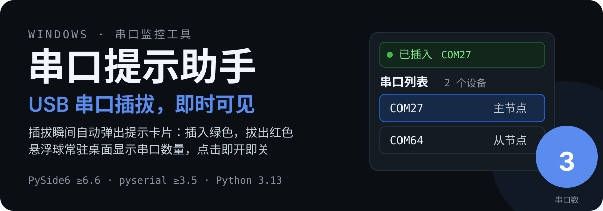
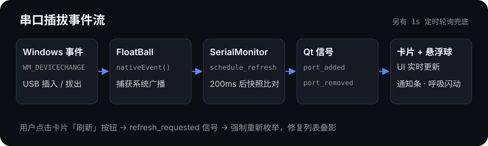

# 串口提示助手

[](https://www.python.org/)
[](https://doc.qt.io/qtforpython-6/)
[](https://github.com/pyserial/pyserial)
[]()

<p align="center">
  
</p>

> Windows 下的 USB 串口插拔监控小工具：设备插入或拔出的瞬间，悬浮球与亚克力卡片即时给出提示，不再需要打开设备管理器反复确认。

## 功能特性

- **秒级感知**：监听 Windows 设备广播（WM_DEVICECHANGE），另配 1s 定时轮询兜底，任何情况都能捕获插拔
- **悬浮球**：常驻桌面的蓝色小球，实时显示当前串口数量；插拔时绿色/红色呼吸闪动
- **提示卡片**：半透明亚克力风格卡片，插入绿色、拔出红色通知条，停留时长可在设置中调整
- **串口识别**：悬停串口行可查看 VID:PID 与制造商，一眼区分 CH340 / FTDI / CP210x；支持备注名（如 `COM27 → 主节点`）
- **外观主题**：托盘「设置…」内可切换悬浮球与卡片主题（深空蓝 / 云白 / 极光紫 / 薄荷 / 黑金 / 珊瑚），卡片风格可选卡片 / 气泡 / 极简，圆角 0~24px（0=直角）、卡片宽度 240~480px、字体 / 字号 / 字体颜色均可调，实时预览
- **开机自启**：托盘菜单一键开关
- **系统托盘**：防误关，随时从托盘重新显示悬浮球、设置或退出
- **单实例 + 日志**：重复启动自动拦截；异常写入 exe 旁 `app.log`（1MB 轮转）

## 工作方式

<p align="center">
  
</p>

- 设备插拔由 `SerialMonitor` 内的原生事件过滤器捕获系统广播，合并去抖后延迟 200ms 刷新（等待驱动枚举完成）
- 刷新时对 pyserial 枚举结果做快照比对，差异通过 Qt 信号 `port_added / port_removed` 广播
- 信号在主入口 `main.py` 统一接线，驱动卡片列表、通知条、悬浮球计数与闪动
- 枚举失败时保留旧状态并记录日志，不会误报设备拔出

## 快速开始

**环境要求**：Windows 10/11，Python 3.13

```powershell
pip install -r requirements.txt
python main.py
```

打包为单文件 exe（无控制台窗口，带自定义图标）：

```powershell
pip install pyinstaller
pyinstaller 串口提示助手.spec
# 产物：dist/串口提示助手.exe
```

## 使用说明

| 交互 | 效果 |
| --- | --- |
| 单击悬浮球 | 显示 / 隐藏提示卡片 |
| 右键单击悬浮球 | 呼出与托盘相同的菜单（显示悬浮球 / 设置… / 开机自启 / 退出） |
| 拖动悬浮球 | 移动位置 |
| 点击卡片中的串口行 | 编辑该串口的备注名 |
| 悬停串口行 | 查看 VID:PID、制造商、备注等完整信息 |
| 拖动卡片底部滑条 | 调整卡片背景透明度 |
| 点击卡片「刷新」按钮 | 强制重新枚举串口（修复列表叠影） |
| 托盘「设置…」→ 外观 | 主题 / 风格 / 圆角 / 卡片宽度 / 字体字号 / 字体颜色 |
| 托盘「设置…」→ 通知 | 通知停留时间 / 自动弹卡 / 拔出提示 |
| 托盘「开机自启」 | 一键开关开机自启 |
| 托盘图标菜单 | 显示悬浮球 / 设置 / 退出程序 |

## 数据文件

程序旁的三个文件（打包版位于 exe 同目录），均为运行时生成：

| 文件 | 内容 |
| --- | --- |
| `port_aliases.json` | 串口备注名，如 `{ "COM27": "主节点" }` |
| `config.json` | 用户设置（外观主题/风格/圆角/宽度/字体、通知时长、自动弹卡、拔出提示） |
| `app.log` | 运行日志，1MB 轮转 |

> [!NOTE]
> 将某个备注编辑为空即删除该条备注；配置修改立即写盘，下次启动自动加载。

## 项目结构

```text
main.py            入口：信号接线 / 托盘菜单 / 日志 / 单实例
card_window.py     提示卡片（串口列表 / 通知条 / 透明度）
float_ball.py      悬浮球（拖动 / 闪动）
serial_monitor.py  串口枚举 / 插拔信号 / 设备广播捕获（PortInfo 含 VID:PID）
alias_store.py     备注名 JSON 持久化
app_config.py      用户设置持久化（config.json）
app_paths.py       数据目录定位（打包版取 exe 目录）
themes.py          外观主题注册表（悬浮球/卡片主题、卡片风格）
autostart.py       开机自启（HKCU Run 注册表）
settings_dialog.py 设置对话框（外观 + 通知，即时生效）
tools/make_icon.py 图标生成脚本（assets/icon.ico）
tests/             pytest 测试套件
```

## 兼容性与限制

- 仅支持 Windows：插拔检测依赖 `WM_DEVICECHANGE` 系统广播
- 单实例运行（重复启动会提示并退出），不提供自动更新
- 界面为模拟亚克力效果（Qt 透明背景 + QSS），兼容性优于依赖系统毛玻璃接口的实现
