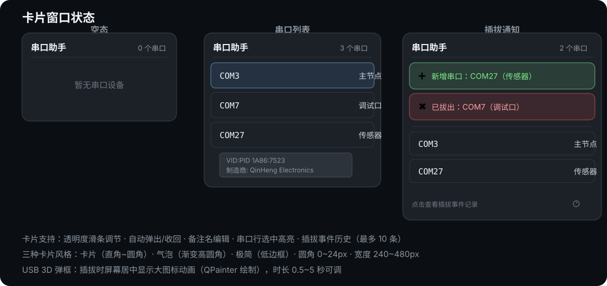
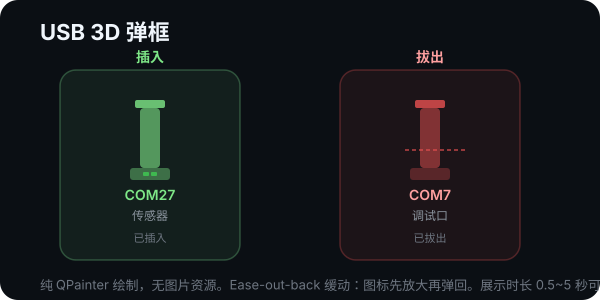
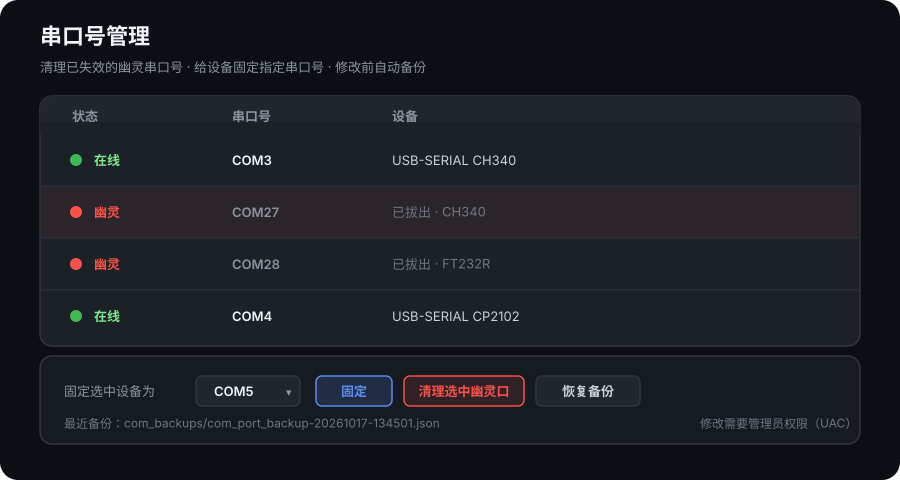
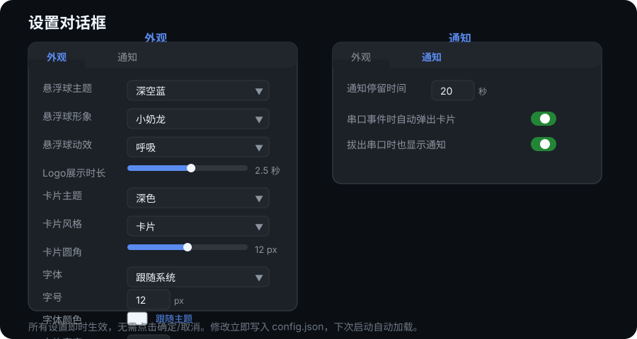

# 串口提示助手

<p align="center">
  
</p>

<p align="center">
  <b>插上就知道，拔掉也看得见。</b><br>
  Windows 桌面常驻的串口监视小工具：USB 串口插拔的瞬间，悬浮球闪动、卡片弹出、3D 弹框居中提醒 —— 再也不用来回翻设备管理器。
</p>

<p align="center">
  <a href="https://github.com/Liruitao1993/serial_notis/releases/latest">
    
  </a>
</p>

<p align="center">
  
  
  
  
  
  
  
</p>

**作者**：[Liruitao1993](https://github.com/Liruitao1993)

---

## 它解决什么问题

| 日常痛点 | 串口提示助手怎么做 |
| --- | --- |
| 插上 USB 转串口，得打开设备管理器确认是 COM 几 | 插上瞬间悬浮球闪绿、卡片弹出，直接显示 COM 号与设备名 |
| 设备掉了没察觉，程序报错才发现冒烟 | 拔出瞬间红色提示，卡片里该口同步移除 |
| 多台设备来回插拔，分不清当前是谁 | 卡片实时列出所有串口，可给每个口写中文备注（如「主节点」） |
| 插拔久了 COM 号漂到 COM27、COM38，程序里写死的 COM3 失效 | 内置**串口号管理**：清理幽灵口号 + 把设备固定到指定 COM 口 |
| 桌面小工具丑、还占地方 | 6 套主题 × 3 种卡片风格，透明度/圆角/宽度/字体全可调，悬浮球能拖到任意角落 |

## 功能亮点

**① 插拔即时感知（双保险）**
监听 Windows 设备广播 `WM_DEVICECHANGE`，另配 1 秒定时轮询兜底；事件到达后延迟 200ms 再枚举（等驱动就绪），枚举失败时保留旧状态，不会误报拔出。

**② 四重视觉反馈，想忽略都难**
悬浮球呼吸闪动（绿/红）、亚克力提示卡片弹出、屏幕居中 USB 3D 弹框、卡片内通知条淡入淡出 —— 各自可单独开关或调时长。

**③ 串口号管理（清理幽灵口 / 固定口号）**
长期插拔后注册表会残留大量已失效的「幽灵」COM 号，新设备因此被分到高编号。这里可以列出所有注册过的串口设备，一键清理幽灵口号，或把某台设备**固定**到指定 COM 口。修改前自动备份，可一键恢复。

**④ 外观完全可定制**
悬浮球主题 6 组、卡片主题 6 组、卡片风格 3 种（卡片/气泡/极简）、圆角 0~24px、宽度 240~480px、字体族与字号、字体颜色、卡片透明度实时可调，设置即时生效。

**⑤ 响应档位：快与省不用二选一**
三档可选：**均衡**（默认，兜底预检 1 秒）、**敏捷**（0.5 秒，响应最快）、**省电**（10 秒 + 动效静止，适合笔记本电池），**自动**档随电源状态切换。因为每轮预检只查一次约 0.12ms 的设备名表、不读注册表，实测各档空闲 CPU 占用都在 0.03% 以内。

---

## 界面一览

### 常驻悬浮球

<p align="center">
  
</p>

- **常态**：显示当前串口数量，蓝色渐变球体
- **插入闪绿**：新设备接入时绿色呼吸闪动 2 秒
- **拔出闪红**：设备断开时红色呼吸闪动 2 秒
- **卡通形象**：小奶龙 / 大白模式，带对话气泡显示串口数

### 提示卡片

<p align="center">
  
</p>

- **空态**：无串口设备时显示「暂无串口设备」
- **串口列表**：按 COM 口编号自然排序（COM10 排在 COM2 之后），支持备注名、选中高亮、悬停详情
- **插拔通知**：绿色/红色通知条自动淡入，到点淡出销毁
- **事件历史**：🕐 按钮展开最近 10 条插拔记录

### USB 3D 弹框

<p align="center">
  
</p>

纯 `QPainter` 绘制的 USB 插头，Ease-out-back 缓动先放大再弹回；插入绿色、拔出红色，展示时长 0.5~5 秒可调。

### 串口号管理

<p align="center">
  
</p>

- **状态列**：绿色「在线」/ 红色「幽灵」（已拔出但仍占用口号）
- **清理幽灵口**：释放残留 COM 号，让新设备拿到低位编号
- **固定口号**：把选中设备锁定到下拉框里指定的 COM 口
- **自动备份 / 恢复**：每次修改前把注册表状态备份到 `com_backups/`，出错可一键回滚

> [!IMPORTANT]
> 读取列表不需要管理员权限；执行「清理 / 固定 / 恢复」时会弹出 UAC 提权（写入 `HKLM` 注册表），改动在设备重新插拔或重启后生效。

### 设置对话框

<p align="center">
  
</p>

**外观标签页**：悬浮球主题/形象/动效、Logo 展示时长、卡片主题/风格/圆角/宽度、字体/字号/字体颜色
**通知标签页**：通知停留时间、自动弹卡开关、拔出提示开关

所有设置即时生效，没有「确定 / 取消」按钮。

---

## 工作方式

<p align="center">
  
</p>

1. **设备广播**：USB 串口插拔触发 Windows `WM_DEVICECHANGE` 系统广播
2. **事件捕获**：`SerialMonitor` 内的 `_DeviceChangeFilter`（`QAbstractNativeEventFilter`）捕获广播，调用 `schedule_refresh()`
3. **延迟刷新**：200ms 单发定时器（合并事件突发），对 pyserial 枚举结果做快照比对
4. **信号广播**：差异通过 Qt 信号 `port_added / port_removed` 广播
5. **UI 更新**：`main.py` 统一接线，驱动卡片列表、通知条、悬浮球计数与闪动、USB 弹框

另有 **1 秒定时轮询**作为兜底检测，即使系统广播丢失也能发现变化。

---

## 快速开始

### 方式一：下载即用（推荐）

1. 打开 [Releases 页面](https://github.com/Liruitao1993/serial_notis/releases/latest)
2. 下载 `SerialNotis-v1.0.1-win64.exe`（单文件，约 48 MB，无需安装 Python）
3. 双击运行，托盘区出现悬浮球即可

> [!NOTE]
> 首次运行 Windows SmartScreen 可能提示「未知发布者」（程序未做代码签名），点 **更多信息 → 仍要运行** 即可。
> 数据文件（配置 / 备注 / 日志）会生成在 exe 同目录，卸载 = 删除 exe 与这些文件。

### 方式二：从源码运行

**环境要求**：Windows 10/11、Python 3.13

```powershell
# 安装运行依赖
pip install -r requirements.txt

# 启动应用
python main.py
```

### 打包为 exe

```powershell
pip install pyinstaller
pyinstaller 串口提示助手.spec
# 产物：dist/串口提示助手.exe
```

打包后为单文件 exe（无控制台窗口，带自定义图标），数据文件自动生成在 exe 同目录。

---

## 使用说明

### 悬浮球交互

| 操作 | 效果 |
| --- | --- |
| 单击 | 显示 / 隐藏提示卡片 |
| 右键单击 | 呼出托盘菜单（显示悬浮球 / 设置 / 串口号管理 / 开机自启 / 退出） |
| 拖动 | 移动悬浮球位置 |

### 卡片交互

| 操作 | 效果 |
| --- | --- |
| 点击串口行 | 选中高亮，再次点击取消 |
| 点击串口行编辑按钮 | 编辑该串口的备注名 |
| 悬停串口行 | 查看 VID:PID、制造商、序列号等完整信息 |
| 拖动透明度滑条 | 实时调节卡片背景透明度（50~235） |
| 点击刷新按钮 ⟳ | 强制重新枚举串口（修复列表叠影） |
| 点击历史按钮 🕐 | 展开/收起插拔事件记录 |

### 托盘菜单

| 菜单项 | 效果 |
| --- | --- |
| 显示悬浮球 | 显示被隐藏的悬浮球 |
| 设置… | 打开设置对话框（外观 + 通知） |
| 串口号管理（清理/固定口号）… | 打开串口号管理对话框 |
| 开机自启 | 一键开关开机自启（写入 HKCU Run 注册表） |
| 退出 | 退出程序（关闭窗口不会退出，防误关） |

### 设置说明

#### 外观设置

| 选项 | 可选值 | 说明 |
| --- | --- | --- |
| 响应档位 | 自动 / 省电 / 均衡 / 敏捷 | 兜底轮询频率 + 事件复核延迟 + 动效帧率；自动档插电用均衡、电池用省电 |
| 悬浮球主题 | 深空蓝 / 云白 / 极光紫 / 薄荷 / 黑金 / 珊瑚 | 渐变双色 + 文字色 + 闪动色 |
| 悬浮球形象 | 经典球 / 小奶龙 / 大白 | 支持图片（`assets/mascots/`）或 QPainter 矢量绘制 |
| 悬浮球动效 | 关 / 呼吸 / 脉冲光环 / 旋转粒子 | 球体周围的视觉动效 |
| Logo 展示时长 | 0.5~5 秒 | USB 弹框展示时长 |
| 卡片主题 | 深色 / 云白 / 极光紫 / 薄荷 / 黑金 / 珊瑚 | 面板/边框/文字/通知条配色 |
| 卡片风格 | 卡片 / 气泡 / 极简 | 影响圆角/边框/背景渐变 |
| 卡片圆角 | 0~24px（0=直角） | 风格会叠加额外圆角 |
| 字体 | 跟随系统 / 任意字体名 | 可下拉选择或手输 |
| 字号 | 8~18px | 标题/计数按比例派生 |
| 字体颜色 | 跟随主题 / 自定义 #RRGGBB | 可选色或重置 |
| 卡片宽度 | 240~480px | 卡片窗口固定宽度 |

#### 通知设置

| 选项 | 可选值 | 说明 |
| --- | --- | --- |
| 通知停留时间 | 5~120 秒 | 通知条自动淡出时间 |
| 串口事件时自动弹出卡片 | 开/关 | 事件时自动显示卡片 |
| 拔出串口时也显示通知 | 开/关 | 关闭后拔出不显示通知条 |

---

## 数据文件

程序旁的文件（打包版位于 exe 同目录），均为运行时自动生成：

| 文件 | 内容 |
| --- | --- |
| `port_aliases.json` | 串口备注名，如 `{ "COM27": "主节点" }` |
| `config.json` | 用户设置（外观主题/风格/圆角/宽度/字体、通知时长、自动弹卡、拔出提示） |
| `app.log` | 运行日志，1MB 轮转 |
| `com_backups/` | 串口号管理每次修改注册表前的自动备份（JSON） |

> [!NOTE]
> 将某个备注编辑为空即删除该条备注；配置修改立即写盘，下次启动自动加载。

---

## 项目结构

```text
main.py                入口：信号接线 / 托盘菜单 / 日志 / 单实例
card_window.py         提示卡片（串口列表 / 通知条 / 事件历史 / 透明度滑条）
float_ball.py          悬浮球（拖动 / 闪动 / 形象绘制 / 动效）
serial_monitor.py      串口枚举 / 插拔信号 / 设备广播捕获（PortInfo 含 VID:PID）
usb_popup.py           USB 3D 弹框（QPainter 绘制 / Ease-out-back 缓动）
mascots.py             卡通形象绘制（小奶龙 / 大白 / 对话气泡）
com_manager.py         串口号管理核心（注册表 ComDB 读写 / 清理 / 固定 / 备份恢复 / UAC 提权）
com_manager_dialog.py  串口号管理对话框（设备表格 / 清理 / 固定 / 恢复备份）
alias_store.py         备注名 JSON 持久化
app_config.py          用户设置持久化（config.json）+ 默认值 + 类型强制
app_paths.py           数据目录定位（打包版取 exe 目录）
themes.py              外观主题注册表（悬浮球/卡片主题、卡片风格、动效、形象列表）
autostart.py           开机自启（HKCU Run 注册表）
settings_dialog.py     设置对话框（外观 + 通知，即时生效）
tools/make_icon.py     图标生成脚本（assets/icon.ico）
tools/bench_cpu.py     CPU 基准（轮询枚举与悬浮球动效重绘开销）
perf_profile.py        响应档位（预检频率 / 事件复核延迟 / 动效帧率 + 电源状态判定）
tests/                 pytest 测试套件（100 个测试）
assets/
  icon.ico             应用图标
  mascots/             卡通形象图片（小奶龙.png）
  readme/              README 配图（SVG）
```

---

## 配置文件示例

`config.json` 完整结构：

```json
{
  "notify_lifetime_ms": 20000,
  "auto_show_card": true,
  "notify_on_remove": true,
  "ball_theme": "深空蓝",
  "ball_mascot": "经典球",
  "ball_animation": "呼吸",
  "popup_duration_ms": 2500,
  "card_theme": "深色",
  "card_style": "卡片",
  "card_radius": 12,
  "card_width": 320,
  "font_family": "",
  "font_size": 12,
  "font_color": "",
  "panel_alpha": 200
}
```

---

## 开发与测试

```powershell
# 安装运行依赖
pip install -r requirements.txt

# 安装开发依赖（测试）
pip install -r requirements-dev.txt

# 运行测试（headless，无需显示器）
python -m pytest tests/ -q

# 运行应用（Windows GUI）
python main.py

# 重新生成图标（仅修改设计时）
python tools/make_icon.py

# 打包为 exe
pyinstaller 串口提示助手.spec
```

### 测试覆盖（100 个测试，全部 headless）

| 文件 | 覆盖内容 |
| --- | --- |
| `test_serial_monitor.py` | 串口枚举 / 差异检测 / 事件过滤 / 故障安全 |
| `test_card_window.py` | 卡片列表重建 / 强制刷新 / 自然排序 / 内容指纹缓存 |
| `test_com_manager.py` | ComDB 位图换算 / 设备列举 / 清理与固定 / 备份恢复 / 提权命令行 |
| `test_perf_profile.py` | 档位参数表完整性 / 单调性 / 电源状态解析与回退 / 设置联动 |
| `test_themes.py` | 主题注册完整性 / 圆角解析 / QSS 应用 / 设置即时生效 |
| `test_app_config.py` | 配置读写 / 类型强制 / 默认值 |
| `test_alias_store.py` | 备注名持久化 |
| `test_autostart.py` | 注册表值构建 |
| `test_icon.py` | 图标有效性 / spec 引用 |
| `test_lock.py` | 单实例锁互斥 |
| `test_smoke.py` | 完整信号接线冒烟测试 |

---

## 兼容性与限制

- **仅支持 Windows**：插拔检测依赖 `WM_DEVICECHANGE` 系统广播；串口号管理依赖 Windows 注册表
- **Python 3.13**：使用了 `int | None` 等 3.10+ 语法
- **单实例运行**：重复启动会提示并退出
- **串口号管理需要管理员权限**：清理/固定口号会弹 UAC；读取列表不需要
- **不提供自动更新**：请到 Releases 页面手动下载新版本
- **界面为模拟亚克力效果**：Qt 透明背景 + QSS rgba，兼容性优于依赖系统毛玻璃接口的实现
- **无类型注解**：公共 API 无 type hints（dataclass 和纯函数除外），基于 pyright strict 模式的警告为预期噪声

---

## 常见问题

**Q：它会监控串口数据吗？**
A：不会。只做「有哪些串口」的枚举与插拔检测，不打开串口、不读取任何数据，因此不会和你的调试工具抢占用。

**Q：为什么插拔后要有 200ms 延迟才刷新？**
A：设备硬件枚举完成需要时间，立即枚举常拿到空结果；延迟 200ms 并合并短时间内的多次广播，结果才稳定。

**Q：串口号固定后为什么没立刻变？**
A：口号写在注册表里，需要设备重新插拔（或重启）后由系统重新分配生效。

**Q：清理幽灵口有风险吗？**
A：每次修改前都会自动备份注册表状态到 `com_backups/`，对话框底部也会显示最近一次备份，可一键恢复。

**Q：多个副屏 / 高 DPI 下会错位吗？**
A：悬浮球可自由拖动，卡片与弹框按主屏居中；高 DPI 缩放已在 Qt 层适配，如有异常欢迎提 Issue。
**Q：它会一直占着 CPU 吗？**
A：几乎不。检测以设备广播事件驱动为主，兜底轮询每轮只做一次约 0.12ms 的廉价检查（`QueryDosDevice`，不读注册表），实测空闲约 0.01%；动效选「关」或在「省电」档时会停止重绘。想更省电，设置里选「省电」档即可。


---

## 反馈与贡献

- 发现 Bug 或有功能建议：请提 [Issue](https://github.com/Liruitao1993/serial_notis/issues)
- 提交代码：Fork 后开 PR，提交前请确保 `python -m pytest tests/ -q` 全绿

## 许可证

[MIT License](https://github.com/Liruitao1993/serial_notis/blob/main/LICENSE)
